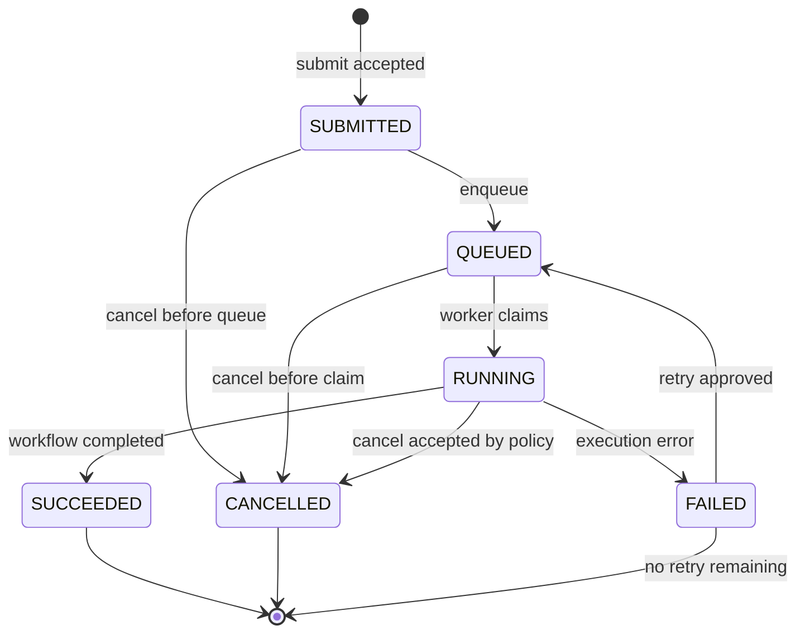

# Job State Machine

## 1. Mục đích và phạm vi

Tài liệu này là hợp đồng trạng thái của `Job` trong Phase 1. Nó trả lời ba câu hỏi:

1. Job có những trạng thái nào?
2. Sự kiện nào được phép chuyển job sang trạng thái mới?
3. Khi chuyển trạng thái, điều kiện và bằng chứng cần có là gì?

Phase 1 chỉ chốt domain contract. Chưa triển khai worker, queue, database migration,
RabbitMQ, Redis, S3 hay AWS.

## 2. Các trạng thái

| State | Ý nghĩa | Terminal? | Có thể retry? | Ai chịu trách nhiệm chính? |
|---|---|---:|---:|---|
| `SUBMITTED` | API đã nhận request hợp lệ và tạo job | Không | Có, nếu chưa được xử lý | API/use case |
| `QUEUED` | Job đã được chấp nhận để chờ thực thi | Không | Có | Dispatcher |
| `RUNNING` | Một execution đang thực thi | Không | Có, nếu execution thất bại | Worker runtime |
| `SUCCEEDED` | Workflow hoàn thành thành công | Có | Không cần | Worker runtime |
| `FAILED` | Workflow không hoàn thành; đã ghi nhận lỗi | Có | Có theo policy retry | Worker/runtime |
| `CANCELLED` | Job bị hủy theo yêu cầu hợp lệ trước terminal state | Có | Không tự động | API/use case |

`Job` là aggregate điều phối. `JobExecution` đại diện cho từng attempt chạy cụ thể.
Một job có thể có nhiều execution, nhưng mỗi `attempt` trong cùng job là duy nhất.

## 3. Sơ đồ chuyển trạng thái

## 4. Transition contract

| From | Event | Guard/điều kiện | To | Side effect tối thiểu |
|---|---|---|---|---|
| none | `SUBMIT_ACCEPTED` | Project tồn tại, workflow thuộc project và đã publish, idempotency key hợp lệ | `SUBMITTED` | Tạo job; ghi `created_at`; lưu request id |
| `SUBMITTED` | `ENQUEUE` | Dispatcher nhận job chưa terminal | `QUEUED` | Phát tín hiệu enqueue một lần theo contract |
| `QUEUED` | `WORKER_CLAIMED` | Worker claim thành công; chưa có execution đang chạy | `RUNNING` | Tạo `JobExecution`; ghi `started_at`, worker id |
| `RUNNING` | `EXECUTION_SUCCEEDED` | Execution hoàn thành đúng output contract | `SUCCEEDED` | Ghi `finished_at`; lưu kết quả tham chiếu nếu có |
| `RUNNING` | `EXECUTION_FAILED` | Execution trả lỗi có thể ghi nhận | `FAILED` | Ghi lỗi an toàn; ghi `finished_at` |
| `FAILED` | `RETRY_APPROVED` | Còn retry; policy cho phép; không bị hủy | `QUEUED` | Tăng attempt khi claim execution kế tiếp |
| `SUBMITTED`/`QUEUED` | `CANCEL_REQUESTED` | Job chưa terminal và policy cho phép hủy | `CANCELLED` | Ghi actor, request id và thời điểm hủy |
| `RUNNING` | `CANCEL_REQUESTED` | Chỉ chấp nhận nếu runtime có cơ chế cancel rõ ràng | `CANCELLED` | Ghi cancellation result; không giả vờ dừng nếu chưa xác nhận |

## 5. Invariants bắt buộc

- `SUCCEEDED`, `FAILED`, `CANCELLED` là terminal state; không được chuyển ra khỏi terminal state.
- Một job chỉ có một trạng thái hiện tại tại một thời điểm.
- `workflow_id` của job phải thuộc cùng `project_id`.
- `attempt` của mỗi `JobExecution` bắt đầu từ 1 và duy nhất trong một job.
- Không tạo execution mới khi job đã `SUCCEEDED` hoặc `CANCELLED`.
- Chỉ `FAILED` mới được retry; retry phải có policy và bằng chứng lỗi.
- Mỗi lần chuyển trạng thái phải có event, actor/worker phù hợp, request id và timestamp.
- Update trạng thái phải có điều kiện trên trạng thái hiện tại (conditional transition) để hai worker không cùng claim một job.

## 6. Quy tắc cạnh tranh và tính quyết định

1. Hai request cùng chuyển một job phải được xử lý như compare-and-set: chỉ một request thắng.
2. Nếu cancel và success xảy ra đồng thời, hệ thống không được trả kết quả mơ hồ. Chỉ transition ghi nhận thành công trong storage mới được coi là kết quả; request còn lại nhận lỗi `INVALID_STATE_TRANSITION` hoặc `JOB_NOT_CANCELLABLE`.
3. Không coi timeout của client là job failure. Client có thể poll bằng `GET /jobs/{jobId}`.
4. Nếu mất kết nối sau khi submit, client gửi lại cùng `Idempotency-Key`; server phải trả cùng logical job, không tạo job thứ hai.

## 7. Bảng transition hợp lệ

| From | Allowed event | To |
|---|---|---|
| `SUBMITTED` | `ENQUEUE` | `QUEUED` |
| `SUBMITTED` | `CANCEL_REQUESTED` | `CANCELLED` |
| `QUEUED` | `WORKER_CLAIMED` | `RUNNING` |
| `QUEUED` | `CANCEL_REQUESTED` | `CANCELLED` |
| `RUNNING` | `EXECUTION_SUCCEEDED` | `SUCCEEDED` |
| `RUNNING` | `EXECUTION_FAILED` | `FAILED` |
| `RUNNING` | `CANCEL_REQUESTED` | `CANCELLED`, chỉ khi có confirmation |
| `FAILED` | `RETRY_APPROVED` | `QUEUED` |

Mọi cặp khác, ví dụ `SUCCEEDED -> RUNNING`, `CANCELLED -> QUEUED` hoặc
`SUBMITTED -> SUCCEEDED`, đều phải trả `INVALID_STATE_TRANSITION`.

## 8. Acceptance scenarios cho Phase 1

| ID | Scenario | Kết quả mong đợi |
|---|---|---|
| SM-01 | Submit hợp lệ | Job bắt đầu ở `SUBMITTED` |
| SM-02 | Enqueue rồi worker claim | `SUBMITTED -> QUEUED -> RUNNING` |
| SM-03 | Execution thành công | `RUNNING -> SUCCEEDED`; không transition tiếp |
| SM-04 | Execution lỗi | `RUNNING -> FAILED`; có error evidence |
| SM-05 | Retry failed job | `FAILED -> QUEUED`; attempt kế tiếp tăng đúng 1 |
| SM-06 | Cancel trước khi chạy | `SUBMITTED/QUEUED -> CANCELLED` |
| SM-07 | Cancel terminal job | HTTP 409 với error code phù hợp |
| SM-08 | Hai worker cùng claim | Chỉ một worker được `RUNNING`; worker kia nhận conflict |

## 9. Cách thực hành local

Không cần database để học contract. Hãy dùng một bảng hoặc unit test in-memory:

1. Tạo job ở `SUBMITTED`.
2. Lần lượt áp dụng event trong bảng transition.
3. Thử một transition hợp lệ và một transition sai.
4. Ghi lại `from`, `event`, `to`, `request_id`, timestamp và kết quả.
5. Lặp lại với duplicate submit, retry sau terminal và cancel khi đang `RUNNING`.

Bằng chứng cần lưu trong lab: input event, state trước/sau, error code, HTTP status
(nếu gọi API) và giải thích vì sao transition được phép hoặc bị từ chối.

## 10. Liên kết tài liệu

- Domain terms: [`domain-glossary.md`](./domain-glossary.md)
- Product contract: [`product-contract.md`](./product-contract.md)
- Use cases: [`use-case-matrix.md`](./use-case-matrix.md)
- Error semantics: [`error-catalog.md`](./error-catalog.md)
- API draft: [`openapi.yaml`](./openapi.yaml)
