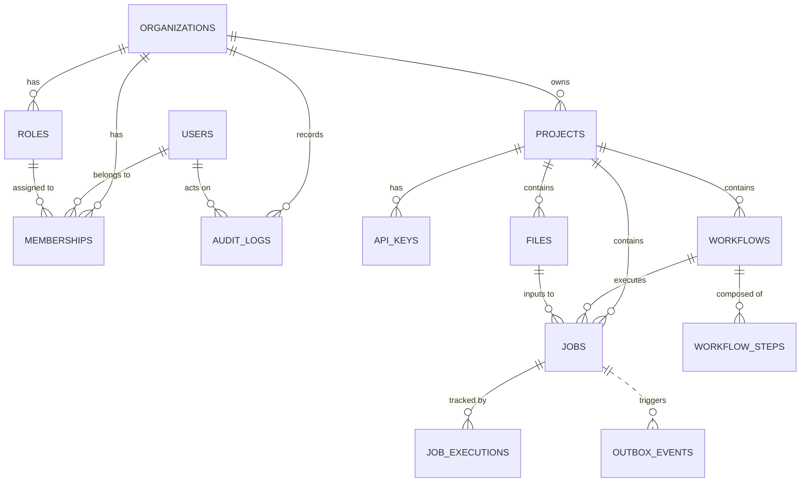

# AtlasFlow - Database Schema Documentation (Phase 3)

Tài liệu chi tiết về thiết kế Cơ sở dữ liệu quan hệ (Relational Database Schema) của hệ thống AtlasFlow trên nền tảng **PostgreSQL 16**.

---

## 1. Nguyên tắc thiết kế cốt lõi

1. **Định danh bằng UUID v4 do ứng dụng sinh ra:**
   - Khóa chính (`PRIMARY KEY`) của tất cả các bảng sử dụng kiểu `UUID`.
   - UUID được sinh ở tầng Application (Java 21 `UUID.randomUUID()`) trước khi thực hiện `INSERT`.
   - Giúp tránh xung đột ID trong hệ thống phân tán, bảo vệ thông tin kinh doanh (tránh tấn công duyệt tuần tự số nguyên).

2. **Chuẩn hóa thời gian (Timezone):**
   - Tất cả các cột thời gian sử dụng kiểu `TIMESTAMPTZ` (Timestamp with Time Zone).
   - Ứng dụng lưu và truy xuất chuẩn hóa theo múi giờ UTC (`ZoneOffset.UTC`).

3. **Bảo vệ toàn vẹn dữ liệu đa tầng:**
   - **Khóa ngoại (`FOREIGN KEY`):** Ràng buộc quan hệ cha-con chặt chẽ giữa các bảng.
   - **Ràng buộc kiểm tra (`CHECK Constraint`):** Ràng buộc tập giá trị Enum (`status`), điều kiện số không âm (`size_bytes >= 0`, `position >= 0`), và cấu trúc dữ liệu (`jsonb_typeof(payload) = 'object'`).
   - **Khóa duy nhất (`UNIQUE Constraint`):** Đảm bảo tính độc nhất theo phạm vi dự án, như `(project_id, idempotency_key)`, `(project_id, version)`.

4. **Tối ưu hóa chỉ mục (Indexes):**
   - Đánh chỉ mục B-Tree trên các trường Foreign Key và Composite Index cho các truy vấn lọc + sắp xếp theo thời gian (`project_id, created_at DESC`).
   - Partial Index cho các bản ghi xử lý bất đồng bộ (`WHERE published_at IS NULL` trên `outbox_events`).

---

## 2. Sơ đồ Thực thể Quan hệ (Entity Relationship Diagram)

---

## 3. Chi tiết các Bảng Dữ liệu (Table Specifications)

### 3.1. `users`
Lưu trữ thông tin tài khoản người dùng đăng nhập hệ thống.

| Tên cột | Kiểu dữ liệu | Ràng buộc | Mô tả |
| :--- | :--- | :--- | :--- |
| `id` | `UUID` | `PRIMARY KEY` | Khóa chính |
| `email` | `VARCHAR(255)` | `NOT NULL` | Email định danh người dùng |
| `password_hash` | `VARCHAR(255)` | `NOT NULL` | Mật khẩu băm (BCrypt/Argon2) |
| `status` | `VARCHAR(32)` | `NOT NULL, CHECK (status IN ('ACTIVE', 'LOCKED', 'DISABLED'))` | Trạng thái tài khoản |
| `created_at` | `TIMESTAMPTZ` | `NOT NULL, DEFAULT CURRENT_TIMESTAMP` | Thời điểm tạo |

* **Index:** `CREATE UNIQUE INDEX uq_users_email_lower ON users (LOWER(email));`

---

### 3.2. `organizations`
Đơn vị thuê (Tenant)/Doanh nghiệp sở hữu các dự án trong AtlasFlow.

| Tên cột | Kiểu dữ liệu | Ràng buộc | Mô tả |
| :--- | :--- | :--- | :--- |
| `id` | `UUID` | `PRIMARY KEY` | Khóa chính |
| `name` | `VARCHAR(255)` | `NOT NULL, CHECK (length(trim(name)) > 0)` | Tên tổ chức |
| `created_at` | `TIMESTAMPTZ` | `NOT NULL, DEFAULT CURRENT_TIMESTAMP` | Thời điểm tạo |

---

### 3.3. `roles`
Vai trò và quyền hạn của thành viên trong phạm vi một organization.

| Tên cột | Kiểu dữ liệu | Ràng buộc | Mô tả |
| :--- | :--- | :--- | :--- |
| `id` | `UUID` | `PRIMARY KEY` | Khóa chính |
| `organization_id` | `UUID` | `NOT NULL, FK -> organizations(id)` | Thuộc tổ chức nào |
| `name` | `VARCHAR(100)` | `NOT NULL, CHECK (length(trim(name)) > 0)` | Tên vai trò (e.g. `OWNER`, `OPERATOR`) |

* **Constraints:**
  - `UNIQUE (id, organization_id)`
  - `UNIQUE (organization_id, name)`

---

### 3.4. `memberships`
Bảng trung gian liên kết Many-to-Many giữa `users` và `organizations`.

| Tên cột | Kiểu dữ liệu | Ràng buộc | Mô tả |
| :--- | :--- | :--- | :--- |
| `user_id` | `UUID` | `NOT NULL, FK -> users(id)` | ID người dùng |
| `organization_id` | `UUID` | `NOT NULL, FK -> organizations(id)` | ID tổ chức |
| `role_id` | `UUID` | `NOT NULL` | ID vai trò |
| `status` | `VARCHAR(32)` | `NOT NULL, CHECK (status IN ('ACTIVE', 'SUSPENDED', 'REVOKED'))` | Trạng thái thành viên |

* **Constraints:**
  - `PRIMARY KEY (user_id, organization_id)`
  - `FOREIGN KEY (role_id, organization_id) REFERENCES roles(id, organization_id)` (Composite FK bảo vệ toàn vẹn phạm vi tổ chức).

---

### 3.5. `projects`
Không gian làm việc chính chứa workflows, files, API keys và jobs.

| Tên cột | Kiểu dữ liệu | Ràng buộc | Mô tả |
| :--- | :--- | :--- | :--- |
| `id` | `UUID` | `PRIMARY KEY` | Khóa chính |
| `organization_id` | `UUID` | `NOT NULL, FK -> organizations(id)` | ID tổ chức sở hữu |
| `name` | `VARCHAR(255)` | `NOT NULL, CHECK (length(trim(name)) > 0)` | Tên project |
| `status` | `VARCHAR(32)` | `NOT NULL, CHECK (status IN ('ACTIVE', 'ARCHIVED', 'SUSPENDED'))` | Trạng thái dự án |
| `created_at` | `TIMESTAMPTZ` | `NOT NULL, DEFAULT CURRENT_TIMESTAMP` | Thời điểm tạo |

* **Constraints:** `UNIQUE (organization_id, name)`
* **Index:** `CREATE INDEX idx_projects_organization_id ON projects (organization_id);`

---

### 3.6. `api_keys`
Khóa xác thực dùng cho Client gọi API vào AtlasFlow.

| Tên cột | Kiểu dữ liệu | Ràng buộc | Mô tả |
| :--- | :--- | :--- | :--- |
| `id` | `UUID` | `PRIMARY KEY` | Khóa chính |
| `project_id` | `UUID` | `NOT NULL, FK -> projects(id)` | Dự án được cấp quyền |
| `prefix` | `VARCHAR(32)` | `NOT NULL, UNIQUE` | Tiền tố nhận diện API Key |
| `secret_hash` | `VARCHAR(255)` | `NOT NULL` | Mã băm của secret (không lưu plaintext) |
| `last_used_at` | `TIMESTAMPTZ` | `NULLABLE` | Thời điểm sử dụng gần nhất |

* **Index:** `CREATE INDEX idx_api_keys_project_id ON api_keys (project_id);`

---

### 3.7. `workflows`
Định nghĩa phiên bản của quy trình xử lý dữ liệu.

| Tên cột | Kiểu dữ liệu | Ràng buộc | Mô tả |
| :--- | :--- | :--- | :--- |
| `id` | `UUID` | `PRIMARY KEY` | Khóa chính |
| `project_id` | `UUID` | `NOT NULL, FK -> projects(id)` | Dự án sở hữu |
| `version` | `INTEGER` | `NOT NULL, CHECK (version > 0)` | Số phiên bản quy trình |
| `status` | `VARCHAR(32)` | `NOT NULL, CHECK (status IN ('DRAFT', 'PUBLISHED', 'ARCHIVED'))` | Trạng thái workflow |

* **Constraints:** `UNIQUE (project_id, version)`
* **Index:** `CREATE INDEX idx_workflows_project_id ON workflows (project_id);`

---

### 3.8. `workflow_steps`
Các bước cấu hình tuần tự bên trong một workflow.

| Tên cột | Kiểu dữ liệu | Ràng buộc | Mô tả |
| :--- | :--- | :--- | :--- |
| `id` | `UUID` | `PRIMARY KEY` | Khóa chính |
| `workflow_id` | `UUID` | `NOT NULL, FK -> workflows(id)` | Workflow chứa bước này |
| `position` | `INTEGER` | `NOT NULL, CHECK (position >= 0)` | Thứ tự thực thi (1, 2, 3,...) |
| `task_type` | `VARCHAR(64)` | `NOT NULL` | Loại task (e.g. `VALIDATE_FILE`, `OCR_FILE`) |
| `config_json` | `JSONB` | `NOT NULL, CHECK (jsonb_typeof(config_json) = 'object')` | Cấu hình tham số dạng JSON object |

* **Constraints:** `UNIQUE (workflow_id, position)`
* **Index:** `CREATE INDEX idx_workflow_steps_workflow_position ON workflow_steps (workflow_id, position);`

---

### 3.9. `files`
Metadata của file tải lên thuộc project.

| Tên cột | Kiểu dữ liệu | Ràng buộc | Mô tả |
| :--- | :--- | :--- | :--- |
| `id` | `UUID` | `PRIMARY KEY` | Khóa chính |
| `project_id` | `UUID` | `NOT NULL, FK -> projects(id)` | Dự án sở hữu |
| `file_name` | `VARCHAR(512)` | `NOT NULL` | Tên gốc của file |
| `object_key` | `VARCHAR(1024)` | `NOT NULL, UNIQUE` | Đường dẫn/Key trên Object Storage/S3 |
| `checksum` | `VARCHAR(128)` | `NULLABLE` | Checksum SHA-256 |
| `size_bytes` | `BIGINT` | `NOT NULL, DEFAULT 0, CHECK (size_bytes >= 0)` | Kích thước file (bytes) |
| `status` | `VARCHAR(32)` | `NOT NULL, CHECK (status IN ('UPLOADING', 'AVAILABLE', 'FAILED'))` | Trạng thái file |
| `created_at` | `TIMESTAMPTZ` | `NOT NULL, DEFAULT CURRENT_TIMESTAMP` | Thời điểm tạo |

* **Index:** `CREATE INDEX idx_files_project_created_at ON files (project_id, created_at DESC);`

---

### 3.10. `jobs`
Yêu cầu thực thi workflow trên một file đầu vào.

| Tên cột | Kiểu dữ liệu | Ràng buộc | Mô tả |
| :--- | :--- | :--- | :--- |
| `id` | `UUID` | `PRIMARY KEY` | Khóa chính |
| `project_id` | `UUID` | `NOT NULL, FK -> projects(id)` | Dự án sở hữu |
| `workflow_id` | `UUID` | `NOT NULL, FK -> workflows(id)` | Workflow được gọi |
| `file_id` | `UUID` | `NOT NULL, FK -> files(id)` | File dữ liệu đầu vào |
| `status` | `VARCHAR(32)` | `NOT NULL, CHECK (status IN ('SUBMITTED', 'QUEUED', 'RUNNING', 'SUCCEEDED', 'FAILED', 'CANCEL_REQUESTED', 'CANCELLED'))` | Trạng thái vòng đời Job |
| `idempotency_key` | `VARCHAR(255)` | `NOT NULL` | Khóa Idempotency từ HTTP Client |
| `request_fingerprint`| `VARCHAR(64)` | `NOT NULL` | SHA-256 hash của request payload |
| `created_at` | `TIMESTAMPTZ` | `NOT NULL, DEFAULT CURRENT_TIMESTAMP` | Thời điểm tạo |

* **Constraints:** `UNIQUE (project_id, idempotency_key)`
* **Indexes:**
  - `CREATE INDEX idx_jobs_project_created_at ON jobs (project_id, created_at DESC);`
  - `CREATE INDEX idx_jobs_workflow_created_at ON jobs (workflow_id, created_at DESC);`

---

### 3.11. `job_executions`
Theo dõi từng lượt chạy (Attempt) của một job khi xảy ra retry.

| Tên cột | Kiểu dữ liệu | Ràng buộc | Mô tả |
| :--- | :--- | :--- | :--- |
| `id` | `UUID` | `PRIMARY KEY` | Khóa chính |
| `job_id` | `UUID` | `NOT NULL, FK -> jobs(id)` | Job tương ứng |
| `attempt` | `INTEGER` | `NOT NULL, CHECK (attempt > 0)` | Lượt chạy thứ mấy (1, 2, 3...) |
| `status` | `VARCHAR(32)` | `NOT NULL, CHECK (status IN ('RUNNING', 'SUCCEEDED', 'FAILED', 'CANCELLED'))` | Trạng thái lượt chạy |
| `worker_id` | `VARCHAR(255)` | `NULLABLE` | ID của Worker node thực thi |
| `started_at` | `TIMESTAMPTZ` | `NOT NULL` | Thời điểm bắt đầu chạy |
| `finished_at` | `TIMESTAMPTZ` | `NULLABLE, CHECK (finished_at IS NULL OR finished_at >= started_at)` | Thời điểm hoàn tất |

* **Constraints:** `UNIQUE (job_id, attempt)`
* **Index:** `CREATE INDEX idx_job_executions_job_id ON job_executions (job_id);`

---

### 3.12. `outbox_events`
Lưu trữ sự kiện miền (Domain Event) theo mẫu Transactional Outbox Pattern để bắn sang Message Broker.

| Tên cột | Kiểu dữ liệu | Ràng buộc | Mô tả |
| :--- | :--- | :--- | :--- |
| `id` | `UUID` | `PRIMARY KEY` | Khóa chính |
| `aggregate_type` | `VARCHAR(64)` | `NOT NULL` | Loại thực thể (e.g. `JOB`, `WORKFLOW`) |
| `aggregate_id` | `UUID` | `NOT NULL` | ID của thực thể |
| `event_type` | `VARCHAR(128)` | `NOT NULL` | Tên sự kiện (e.g. `JOB_SUBMITTED`) |
| `payload` | `JSONB` | `NOT NULL, CHECK (jsonb_typeof(payload) = 'object')` | Dữ liệu sự kiện dạng JSON |
| `published_at` | `TIMESTAMPTZ` | `NULLABLE` | `NULL` = Chưa gửi; `NOT NULL` = Đã publish |

* **Partial Index:** `CREATE INDEX idx_outbox_unpublished ON outbox_events (published_at, id) WHERE published_at IS NULL;`

---

### 3.13. `audit_logs`
Ghi lại nhật ký kiểm toán và truy vết hành vi người dùng trong hệ thống.

| Tên cột | Kiểu dữ liệu | Ràng buộc | Mô tả |
| :--- | :--- | :--- | :--- |
| `id` | `UUID` | `PRIMARY KEY` | Khóa chính |
| `organization_id` | `UUID` | `NOT NULL, FK -> organizations(id)` | Tổ chức xảy ra hành động |
| `actor_id` | `UUID` | `NULLABLE, FK -> users(id)` | Người dùng thực hiện |
| `action` | `VARCHAR(128)` | `NOT NULL` | Hành động thực hiện |
| `resource_type` | `VARCHAR(64)` | `NOT NULL` | Loại tài nguyên bị tác động |
| `resource_id` | `UUID` | `NULLABLE` | ID tài nguyên |
| `request_id` | `VARCHAR(255)` | `NULLABLE` | `X-Request-Id` tương ứng từ HTTP Request |
| `created_at` | `TIMESTAMPTZ` | `NOT NULL, DEFAULT CURRENT_TIMESTAMP` | Thời điểm ghi log |

* **Index:** `CREATE INDEX idx_audit_logs_organization_created_at ON audit_logs (organization_id, created_at DESC);`
