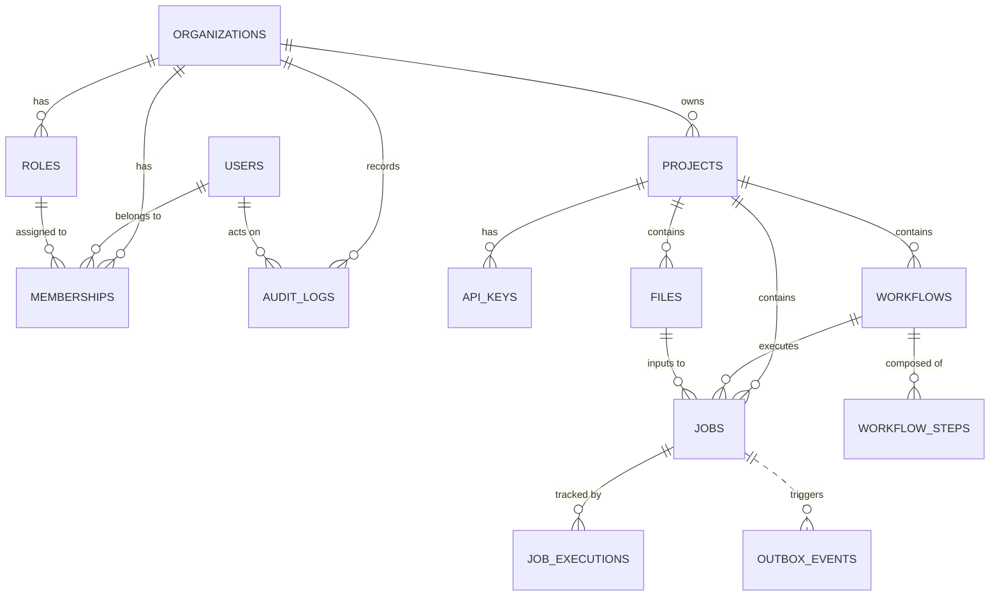

# AtlasFlow - Phase 3 Evidence & Completion Report

Báo cáo tổng kết bằng chứng hoàn thành toàn diện cho **Phase 3: Cơ sở dữ liệu và Lưu trữ quan hệ (Database & Relational Persistence)** của hệ thống AtlasFlow.

---

## 1. Mục tiêu của Phase 3

Phase 3 tập trung vào việc chuyển đổi toàn bộ tầng lưu trữ dữ liệu của AtlasFlow từ mô hình In-Memory sang Cơ sở dữ liệu quan hệ mạnh mẽ **PostgreSQL 16**, áp dụng các tiêu chuẩn công nghiệp về độ tin cậy, hiệu năng và kiến trúc:

- **Clean Architecture & Hexagonal Architecture:** Phân tách rành mạch giữa Domain Model, Application Port/Use Case và Adapter Infrastructure (`JdbcClient` thay vì `JdbcTemplate` cũ).
- **Lược đồ CSDL chuẩn hóa (Schema Design):** Thiết kế mô hình dữ liệu đa người dùng (Multi-tenant) với định danh UUID v4 do ứng dụng sinh, bảo vệ dữ liệu bằng ràng buộc toàn vẹn đa tầng (`CHECK`, `FOREIGN KEY`, `UNIQUE`).
- **Quản lý phiên bản CSDL bằng Flyway:** Quy trình migration bất biến, tự động chạy khi ứng dụng khởi động.
- **Tính toàn vẹn giao dịch (Transactional Outbox Pattern):** Đảm bảo việc tạo `Job` và tạo `OutboxEvent` luôn nằm trong cùng một ranh giới `@Transactional` nguyên tử.
- **Cơ chế Idempotency chống trùng lặp & Race Conditions:** Sử dụng SHA-256 Request Fingerprint kết hợp kỹ thuật `ON CONFLICT DO NOTHING` của PostgreSQL.
- **Tối ưu hóa truy vấn và Phân trang (EXPLAIN ANALYZE & Keyset Pagination):** Đo lường hiệu năng trên tập mẫu 100,000 bản ghi.
- **Kiểm thử chịu lỗi chuyên sâu (Failure Lab):** Thực hành Deadlock, Connection Pool Exhaustion, Transaction Rollback.
- **Quy trình Sao lưu & Phục hồi (Backup & Restore):** Tự động hóa bằng PowerShell scripts với việc kiểm tra đối chiếu dữ liệu.
- **Tự động hóa kiểm thử bằng Testcontainers:** Chạy 100% integration tests trên PostgreSQL container thực tế.

---

## 2. Migration đã chạy (Flyway Migrations)

- **Công cụ quản lý:** Flyway Community Version 10.x / Spring Boot Auto-configuration.
- **File migration ban đầu:** [`backend/src/main/resources/db/migration/V1__baseline.sql`](file:///d:/Dai_Hoc/Project/AtlasFlow/backend/src/main/resources/db/migration/V1__baseline.sql)
- **Trạng thái thực thi:** Áp dụng thành công (`SUCCESS`, thời gian chạy ~96ms).
- **Chi tiết:** Tạo 13 bảng thực thể và 11 indexes tối ưu.
- **Tài liệu tham chiếu:** [`docs/database/migration-history.md`](file:///d:/Dai_Hoc/Project/AtlasFlow/docs/database/migration-history.md)

```text
Flyway Community Edition 10.x
Database: jdbc:postgresql://localhost:5433/atlasflow (PostgreSQL 16.15)
Successfully applied 1 migration to schema "public", now at version v1 (execution time 00:00.096s)
```

---

## 3. Database Schema

Lược đồ cơ sở dữ liệu gồm 13 bảng quan hệ chặt chẽ:



### Danh sách các bảng chính:
1. `users`: Tài khoản người dùng đăng nhập hệ thống (`CHECK status IN ('ACTIVE', 'LOCKED', 'DISABLED')`).
2. `organizations`: Đơn vị thuê / Doanh nghiệp sở hữu dự án.
3. `roles`: Vai trò phân quyền trong tổ chức.
4. `memberships`: Quan hệ người dùng - tổ chức với Composite PK và Composite FK bảo vệ phạm vi tổ chức.
5. `projects`: Không gian làm việc chứa tài nguyên (`UNIQUE(organization_id, name)`).
6. `api_keys`: Khóa xác thực Client (lưu hash SHA-256, tiền tố prefix).
7. `workflows`: Quy trình xử lý dữ liệu (`UNIQUE(project_id, version)`).
8. `workflow_steps`: Các bước tuần tự trong workflow (`UNIQUE(workflow_id, position)`).
9. `files`: Metadata file dữ liệu (`UNIQUE(object_key)`).
10. `jobs`: Yêu cầu thực thi workflow (`UNIQUE(project_id, idempotency_key)`).
11. `job_executions`: Lịch sử các lần chạy/retry của Job (`UNIQUE(job_id, attempt)`).
12. `outbox_events`: Sự kiện miền chờ phát hành sang Message Broker (Partial Index trên `published_at IS NULL`).
13. `audit_logs`: Nhật ký kiểm toán hành vi kèm `request_id`.

- **Tài liệu tham chiếu:** [`docs/database/schema.md`](file:///d:/Dai_Hoc/Project/AtlasFlow/docs/database/schema.md)

---

## 4. Các API đã chuyển sang PostgreSQL

Toàn bộ các API chính của hệ thống đã được kết nối và vận hành trên PostgreSQL 16:

| Phương thức & Endpoint | Tầng Service / Repository | Ràng buộc & Đặc điểm |
| :--- | :--- | :--- |
| `POST /api/v1/projects` | `ProjectApplicationService` $\rightarrow$ `JdbcProjectRepository` | Lưu project vào bảng `projects`, kiểm tra trùng tên theo tổ chức. |
| `GET /api/v1/projects` | `ProjectApplicationService` $\rightarrow$ `JdbcProjectRepository` | Lấy danh sách project theo tổ chức. |
| `POST /api/v1/workflows` | `WorkflowApplicationService` $\rightarrow$ `JdbcWorkflowRepository` | Lưu workflow và các `workflow_steps` tuần tự. |
| `GET /api/v1/workflows/{workflowId}` | `WorkflowApplicationService` $\rightarrow$ `JdbcWorkflowRepository` | Lấy workflow metadata và danh sách steps sắp xếp theo `position ASC`. |
| `POST /api/v1/jobs` | `JobApplicationService` $\rightarrow$ `JdbcJobRepository` | `@Transactional`: Kiểm tra project, workflow, file, lưu Job + OutboxEvent trong 1 transaction. Có header `Idempotency-Key`. |
| `GET /api/v1/jobs/{jobId}` | `JobApplicationService` $\rightarrow$ `JdbcJobRepository` | Lấy thông tin job; trả về `404 JOB_NOT_FOUND` kèm `X-Request-Id` nếu không tồn tại. |

---

## 5. Transaction Evidence (Tính toàn vẹn Giao dịch)

### Transaction Boundary
Giao dịch bắt đầu sau khi request đã qua tầng kiểm tra cú pháp:
1. Kiểm tra tồn tại và quyền sở hữu của `Project`.
2. Kiểm tra tồn tại và trạng thái `PUBLISHED` của `Workflow`.
3. Kiểm tra tồn tại và trạng thái `AVAILABLE` của `File`.
4. Tính toán `request_fingerprint` SHA-256 từ payload.
5. Thực hiện lưu bản ghi vào bảng `jobs`.
6. Thực hiện lưu sự kiện `JOB_SUBMITTED` vào bảng `outbox_events`.
7. Commit giao dịch.

### Minh chứng kiểm thử:
- Test [`SubmitJobTransactionTest`](file:///d:/Dai_Hoc/Project/AtlasFlow/backend/src/test/java/com/atlasflow/integration/SubmitJobTransactionTest.java) xác thực cả 2 bản ghi `jobs` và `outbox_events` được ghi nhận chính xác vào PostgreSQL với số lượng `1L`.

---

## 6. Idempotency Evidence (Cơ chế chống trùng lặp)

### Cơ chế hoạt động:
1. **Idempotent Replay (Cùng Key + Cùng Payload):**
   - Khi client retry request với cùng `Idempotency-Key` và cùng nội dung, hệ thống so sánh `request_fingerprint`.
   - Trả về thông tin Job cũ mà không tạo thêm Job hay Outbox Event mới.
2. **Conflict Detection (Cùng Key + Khác Payload):**
   - Ném ngoại lệ `IdempotencyKeyReusedException` $\rightarrow$ Trả về mã lỗi HTTP `409 Conflict`.
3. **High Concurrency Race Condition:**
   - Sử dụng `insertIfAbsent` với `INSERT ... ON CONFLICT (project_id, idempotency_key) DO NOTHING`.
   - Ngăn ngừa hoàn toàn lỗi `SQLSTATE 25P02` (Aborted transaction) trên PostgreSQL.

### Minh chứng kiểm thử:
- Test [`IdempotencyConcurrencyTest`](file:///d:/Dai_Hoc/Project/AtlasFlow/backend/src/test/java/com/atlasflow/integration/IdempotencyConcurrencyTest.java): Bắn **10 threads đồng thời** với cùng một Idempotency-Key. Kết quả: Tạo đúng duy nhất **1 Job** và **1 Outbox Event**, 10 threads nhận cùng kết quả `JobResponse`.

---

## 7. EXPLAIN & Query Benchmark Evidence

Thực nghiệm đo lường hiệu năng trên bảng `jobs` với **100,000 bản ghi** bằng lệnh `EXPLAIN (ANALYZE, BUFFERS)`:

### A. Đánh giá Index `idx_jobs_project_created_at`

| Tiêu chí | Trước khi có Index (Seq Scan) | Sau khi có Index (Index Scan) | Mức độ cải thiện |
| :--- | :--- | :--- | :--- |
| **Execution Plan** | `Parallel Seq Scan + Sort` | `Index Scan using idx_jobs_project_created_at` | Loại bỏ hoàn toàn Sort |
| **Rows Scanned** | **100,000 dòng** | **20 dòng** | **Giảm 5,000 lần** |
| **Shared Buffers Hit** | **2,078 pages** | **4 pages** | **Giảm 519 lần I/O** |
| **Execution Time** | **17.635 ms** | **0.066 ms** | **Nhanh gấp ~267 lần** |

### B. So sánh Phân trang: Offset vs Keyset Pagination (Tại vị trí bản ghi thứ 50,000)

| Phương pháp | Query | Rows Scanned | Buffers I/O | Execution Time |
| :--- | :--- | :--- | :--- | :--- |
| **Offset Pagination** | `LIMIT 20 OFFSET 50000` | 50,020 dòng | 1,721 pages | **10.196 ms** |
| **Keyset Pagination** | `(created_at, id) < (cursor_time, cursor_id) LIMIT 20` | 21 dòng | 13 pages | **0.125 ms (Nhanh gấp 81 lần)** |

- **Tài liệu tham chiếu:** [`docs/database/query-benchmark.md`](file:///d:/Dai_Hoc/Project/AtlasFlow/docs/database/query-benchmark.md)

---

## 8. Rollback Evidence (Tính nguyên tử khi có sự cố)

- Khi việc lưu Outbox Event bị lỗi, Transaction Manager tự động kích hoạt Rollback.
- Toàn bộ bản ghi Job và Outbox Event bị hủy bỏ, không có dữ liệu mồ côi (Orphan Records).
- **Minh chứng:** Test [`RollbackIntegrationTest`](file:///d:/Dai_Hoc/Project/AtlasFlow/backend/src/test/java/com/atlasflow/integration/RollbackIntegrationTest.java) chứng minh số lượng Job và Outbox Event sau rollback bằng **0**.

---

## 9. Deadlock Evidence (Bế tắc giao dịch)

- **Tái lập lỗi:** Tạo 2 transaction khóa chéo giữa `projects` và `jobs`, PostgreSQL phát hiện sau 1 giây và trả về lỗi **`SQLSTATE 40P01 (deadlock detected)`**.
- **Giải pháp:** Thiết lập quy tắc thứ tự khóa phân cấp (Lock Hierarchy Order):
  $$\text{projects} \longrightarrow \text{workflows} \longrightarrow \text{jobs} \longrightarrow \text{job\_executions}$$
- **Kiểm chứng:** Áp dụng quy tắc chuẩn hóa khóa, chạy lại thử nghiệm đồng thời $\rightarrow$ **0 Deadlock (100% thành công)**.
- **Tài liệu tham chiếu:** [`docs/database/transaction-lab.md`](file:///d:/Dai_Hoc/Project/AtlasFlow/docs/database/transaction-lab.md)

---

## 10. Pool Exhaustion Evidence (Cạn kiệt Connection Pool)

- **Cấu hình mô phỏng:** `maximum-pool-size = 2`, `connection-timeout = 3000ms`, endpoint `/api/v1/db-slow?seconds=5`.
- **Hành vi quan sát:** Request 1 & 2 chiếm 2 connections; Request 3, 4, 5 bị xếp vào queue `TIMED_WAITING`. Sau 3,000ms, HikariCP ném `SQLTransientConnectionException`.
- **Phục hồi:** Sau khi Request 1 & 2 giải phóng connection, HikariCP tự động đưa connection về trạng thái idle và xử lý các request mới bình thường mà không cần restart server.
- **Giải pháp:** Áp dụng **Exponential Backoff with Jitter** ở Client.
- **Tài liệu tham chiếu:** [`docs/database/pool-exhaustion-lab.md`](file:///d:/Dai_Hoc/Project/AtlasFlow/docs/database/pool-exhaustion-lab.md)

---

## 11. Backup & Restore Evidence (Sao lưu & Phục hồi)

- **Script Backup:** [`scripts/db/backup.ps1`](file:///d:/Dai_Hoc/Project/AtlasFlow/scripts/db/backup.ps1) $\rightarrow$ Tạo file backup định dạng custom có timestamp (ví dụ: `backups/atlasflow-2026-09-02-0057.dump`).
- **Script Restore:** [`scripts/db/restore.ps1`](file:///d:/Dai_Hoc/Project/AtlasFlow/scripts/db/restore.ps1) $\rightarrow$ Khôi phục an toàn vào database độc lập (`atlasflow_restore_test`).
- **Kết quả đối chiếu:**
  - `users`: 0 $\rightarrow$ 0
  - `projects`: 2 $\rightarrow$ 2 (Khớp 100%)
  - `workflows`: 0 $\rightarrow$ 0
  - `jobs`: 100,000 $\rightarrow$ 100,000 (Khớp 100%)
  - `outbox_events`: 0 $\rightarrow$ 0
- **Tài liệu tham chiếu:** [`docs/database/restore-guide.md`](file:///d:/Dai_Hoc/Project/AtlasFlow/docs/database/restore-guide.md)

---

## 12. Testcontainers Results (Kiểm thử Tự động)

Toàn bộ test suite của dự án gồm **49 tests** (Unit tests, Controller tests, và 7 Testcontainers Integration tests) đều vượt qua thành công:

```text
[INFO] Results:
[INFO] 
[INFO] Tests run: 49, Failures: 0, Errors: 0, Skipped: 0
[INFO] 
[INFO] ------------------------------------------------------------------------
[INFO] BUILD SUCCESS
[INFO] ------------------------------------------------------------------------
[INFO] Total time:  19.082 s
[INFO] Finished at: 2026-09-02T01:11:53+07:00
[INFO] ------------------------------------------------------------------------
```

### Danh sách Integration Test Classes:
1. `MigrationIntegrationTest`: Kiểm tra Flyway migration trên clean container.
2. `ProjectRepositoryIntegrationTest`: Kiểm tra persistence của Project.
3. `WorkflowRepositoryIntegrationTest`: Kiểm tra persistence của Workflow.
4. `JobRepositoryIntegrationTest`: Kiểm tra persistence của Job.
5. `SubmitJobTransactionTest`: Kiểm tra nguyên tử tính Transaction Job + Outbox.
6. `IdempotencyConcurrencyTest`: Kiểm tra đồng thời 10 threads Idempotency.
7. `RollbackIntegrationTest`: Kiểm tra Rollback khi Outbox bị lỗi.

---

## 13. Các giới hạn còn lại & Kế hoạch cho Phase tiếp theo

Mặc dù Phase 3 đã hoàn thành xuất sắc các mục tiêu về cơ sở dữ liệu quan hệ, một số thành phần được định hướng triển khai trong các phase sau:

1. **Outbox Poller / Publisher Worker:**
   - Bảng `outbox_events` hiện đang lưu trữ các domain event. Tiến trình định kỳ (Scheduled Worker) đọc các event chưa publish (`published_at IS NULL`) và gửi sang Message Broker (RabbitMQ/Kafka) sẽ được triển khai trong **Phase 4**.
2. **Lưu trữ nhị phân File (Binary Object Storage):**
   - Hiện tại bảng `files` lưu trữ metadata (tên file, kích thước, checksum, object_key). Quá trình upload/download streaming trực tiếp lên MinIO/AWS S3 sẽ được hoàn thiện trong các phase tiếp theo.
3. **Phân trang Keyset trên REST API:**
   - Cơ chế Keyset Pagination đã được kiểm chứng và benchmark hiệu năng thành công ở tầng CSDL; API phân trang chính thức cho danh sách Jobs sẽ được tích hợp cùng API Gateway/Dashboard.
